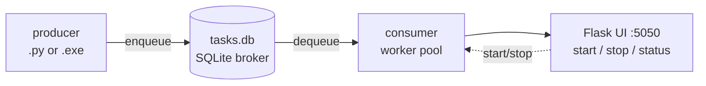

# huey_producer_consumer_flask

A reference template combining a [Huey](https://huey.readthedocs.io) task queue with a Flask control panel so a worker pool can be paused/resumed from a browser at runtime. Pick it up when you want a long-running consumer process whose state you can flip without restarting the program — and one that can be shipped either as a Windows `.exe` or via Docker Compose.

The stack:

- **Huey** (SQLite-backed broker) — producer enqueues, consumer dequeues
- **Flask + [transitions](https://github.com/pytransitions/transitions) state machine** — a tiny `/start`, `/stop`, `/status` UI that drives the consumer's lifecycle
- **Loguru** with a stdlib-logging intercept so third-party libs flow into the same sinks
- **PyArmor + PyInstaller** for shipping producer/consumer as Windows `.exe`
- **Docker Compose** as the alternative deployment

I've used the same stack (including the build + licensing path) in production, so the template aims to be opinionated rather than minimal.

## Architecture



The producer is intentionally tiny: in a real deployment it would only enqueue task IDs from your domain database. The interesting bit is the consumer side, where a `transitions`-based state machine wraps `huey.Consumer` so the Flask routes can toggle `running ↔ stopped` without bouncing the process.

### Scaling: one process per queue

The template is deliberately scoped to **one Huey broker, one consumer process, one Flask UI**. If you need multiple queues — for example a fast queue for low-latency work and a slow queue for batch jobs — the intended pattern is to run them as **separate processes**: separate terminals during development, or separate Docker services in production. Each pair has its own `tasks.db`, its own consumer pool, and its own Flask port.

This matches how Huey itself is designed (one `Huey` instance per broker; the `@huey.task` registry is per-instance) and keeps the consumer's state machine simple — there's deliberately no in-process registry of multiple queues. Scale out by duplicating the `consumer` service in `docker-compose.yml`, pointing it at a second config file with a different `task_database` and `flask.port`, and adding a matching producer for that broker.

## How to develop
New tasks can be created under [commons/tasks](/src/commons/tasks); the task should be imported by the producer to be enqueued, and is automatically registered on the consumer side via the shared `commons` import.

After creating your code, run `tox`* which is already configured to lint and format your code, then run any tests. Fix anything if needed, that's it
Use `tox l` to view all available environments, then run one using `tox -e <env_name>`

\* If you don't know what it is, [take a look here](https://tox.wiki). It will be installed when you run `pip install -r requirements.txt`

## How to configure:
Use the config file located at [config.yaml](/src/config.yaml)

## How to execute:
Commands should be executed at git root directory, where `build_scripts`, `src` and `tests` folders are.

Changing directory to either producer/consumer will help as paths that use dot notation will begin from the folder that you changed into, example:  
`cd src/producer` then run `main.py` either on vscode or terminal,  
This will cause parsing of `config.yaml` to handle dot path as the current folder (`src/producer`), and double dot as upper folder (`src`)  
This is not a big issue but can led to unexpected things, if you don't cd and run from git root the `task.db` will be created here instead of being in `src`  

### producer
Change directory to producer `cd src/producer` then execute `python main.py`

This will create some tasks in sqlite db, consumer will process them.

### consumer
Change directory to consumer with `cd src/consumer` then execute `python main.py`

Consumer will start a Flask server on port 5050 (default), open <http://127.0.0.1:5050> in your browser then click on `Start`. You should see on the terminal:

```
The following commands are available:
+ commons.tasks.example.get_url
+ commons.tasks.example.every_minute
```

The example task uses `requests` to fetch a URL. Selenium / chromedriver tasks plug into the same `@huey.task` decorator if you need browser automation — nothing about the template assumes one over the other.

## Testing
There are some example tests in [tests](/tests) folder in git root. Since the producer is intentionally trivial, the tests focus on the consumer's Flask endpoints and the tasks themselves.
The tests are run using `tox` command, every environment runs all tests.

### coverage
When using `tox` to test, coverage report are generated as well, this can be served using:
`python -m http.server -d htmlcov`
in project root, then [open it in your browser](http://127.0.0.1:8000)

## Builds
Tested on Windows 11 with Python 3.9 (the Dockerfiles also use `python:3.9-alpine3.19`). `tox -e build_producer_consumer_exe` uses `build_scripts` to generate two `.exe` files in the `deployed/` folder via pyarmor. PyArmor is intentionally pinned at `7.7.4` — v8 dropped the `pack` / `licenses` subcommands this build relies on, so upgrading requires a rewrite of `build_scripts/helpers.py`. 

## Docker run
Run using `docker compose up -d --build`, then on terminal run `docker ps` to view running images:
```terminal
CONTAINER ID   IMAGE                                   COMMAND                  CREATED         STATUS                 PORTS                     NAMES
2627969d19d5   huey_producer_consumer_flask-consumer   "python app/main.py"     3 minutes ago   Up 3 minutes           0.0.0.0:50050->5050/tcp   huey_producer_consumer_flask-consumer-1

```
as producer dies rather quickly its normal to have only the consumer running
